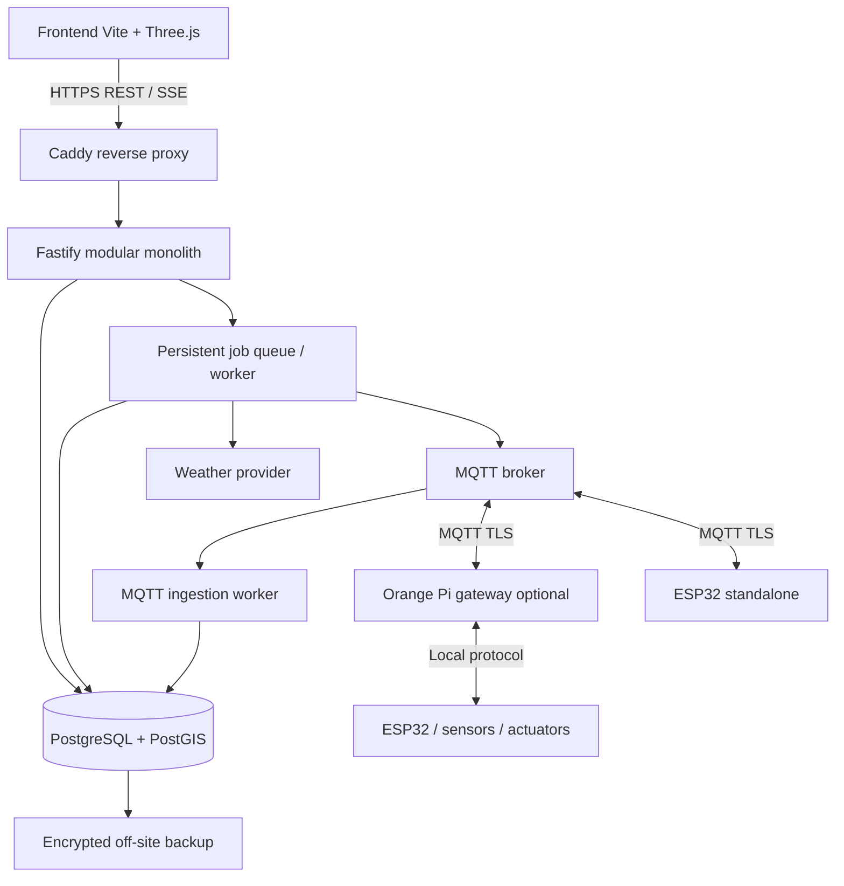

# Automotion Platform — Server Architecture & Engineering Guideline

| Atribut | Keterangan |
|---|---|
| Versi | 1.0 — baseline usulan implementasi |
| Status | Proposed; perlu review tim sebelum production |
| Cakupan | Backend, database, geospatial, intelligence, IoT, edge, deployment |
| Repository | rizkyarfians/Greenhouse-Edukatif |
| Branch pengembangan | main |
| Pemilik dokumen | Tim pengembangan Automotion |
| Review | Setiap cycle dan setiap perubahan arsitektur, keamanan atau kontrak data |

## 1. Tujuan dan ruang lingkup

Automotion adalah platform pertanian terpadu untuk greenhouse dan lahan terbuka. Server menyediakan fondasi bersama untuk pengukuran lahan, penyimpanan proyek, analisis iklim, rekomendasi tanaman, simulasi 3D, monitoring IoT dan otomasi yang aman. Target pengguna mencakup petani, perusahaan, kelompok tani dan institusi pendidikan/riset.

Dokumen ini adalah acuan engineering, bukan klaim bahwa backend sudah terpasang atau sistem siap mengendalikan perangkat fisik. Frontend Cycle 01–04 telah diimplementasikan di repository, tetapi build, integrasi API, uji perangkat, visual, dan validasi agronomi belum seluruhnya diverifikasi. Cycle 05 IoT belum menjadi layanan production.

## 2. Prinsip wajib

1. **Multi-land first:** semua model domain dan fitur baru mempertimbangkan greenhouse dan lahan terbuka. Perbedaan budidaya ditangani oleh konfigurasi dan strategi domain, bukan duplikasi aplikasi.
2. **Mode isolation:** simulation, planning/advisory dan connected farm terpisah secara eksplisit pada domain, penyimpanan dan otorisasi. Simulasi tidak dapat memicu command fisik.
3. **Modular monolith first:** satu backend Node.js dengan modul domain independen; worker dan MQTT broker berjalan sebagai proses/service terpisah. Microservices hanya jika hasil pengukuran beban/organisasi membenarkannya.
4. **Cloud–edge hybrid:** cloud bertanggung jawab untuk akun, penyimpanan dan analisis; edge/firmware bertanggung jawab untuk kontrol lokal yang aman, offline operation dan interlock.
5. **API contract first:** kontrak API, schema, unit, error dan versi disepakati sebelum frontend, gateway atau firmware terintegrasi.
6. **Security and privacy by default:** least privilege, isolasi tenant, TLS, secrets di luar repo, auditability, minimalisasi data lokasi.
7. **Explainable intelligence:** aturan dan model agronomi dapat ditelusuri; data kosong/stale tidak dianggap normal. LLM bukan pengendali aktuator.
8. **Incremental delivery:** tiap cycle memiliki scope, migration, pengujian, acceptance criteria, rollback, dan catatan commit. Seluruh perubahan masuk main tanpa force push; branch lama hanya arsip. Jangan menimpa fitur yang sudah ada.

## 3. Product modes

| Mode | Data | Kemampuan | Akses hardware |
|---|---|---|---|
| Simulation | Dummy/virtual, berlabel jelas | Edukasi, 3D, coba irigasi, simpan sesi | Tidak ada |
| Planning & Advisory | Polygon, input lapangan, iklim model | Rekomendasi tanaman, estimasi, layout | Tidak ada |
| Connected Farm | Telemetry perangkat yang terdaftar dan tervalidasi | Monitoring, advisory, command terotorisasi, otomasi terbatas | Ada, setelah commissioning dan persetujuan |

Mode terikat pada proyek/farm atau sesi, ditentukan server, bukan dipercaya dari body request. Perubahan menjadi Connected Farm perlu provisioning, mapping perangkat, verifikasi hak akses dan commissioning. Akun guest tetap bisa memakai simulasi dan perencanaan lokal; migrasi guest ke cloud dilakukan dengan persetujuan.

## 4. Target arsitektur



Frontend: UI, kamera/GPS dengan izin, preview geometri, rendering 3D, dan simulasi lokal. Server: canonical polygon/area, data ownership, storage, recommendation, ingestion, authorization dan command orchestration. Edge: buffer offline, local state machine, interlock, acknowledgement dan watchdog. Firmware: pembacaan sensor dan kontrol output dengan hard safety limit. Koneksi internet tidak boleh menjadi prasyarat untuk mematikan aktuator secara aman.

### 4.1 Stack baseline

| Komponen | Pilihan | Catatan |
|---|---|---|
| Frontend | Vite + Three.js existing | Pertahankan fitur guest dan simulator |
| API | Node.js LTS + Fastify | Modul domain, schema validation, OpenAPI |
| Database | PostgreSQL + PostGIS | Relasional, geospatial, transaksi |
| Realtime web | SSE | Read-only event stream, reconnect/resync |
| Worker | Node.js, persistent job table PostgreSQL | Retry terbatas, idempotency, scheduling |
| IoT | Eclipse Mosquitto + MQTT client | TLS, ACL, kredensial per device |
| Edge | Orange Pi (opsional) | Buffer lokal dan otomasi onsite |
| Firmware | ESP32 | Device identity, watchdog, safety |
| Intelligence | JavaScript rules; Python jika dibutuhkan | Versi model, testable functions |
| Infrastruktur | Caddy + Docker Compose | Satu VPS pilot, network privat |
| Observability | Structured logs, metrics, health checks | Alert dan tracing request ID |
| Source control | GitHub main | CI dan perubahan kecil |

Versi dependency harus dipin melalui lockfile, image version atau digest; pilih versi supported saat implementasi. Redis, Kubernetes, GPU dan microservices bukan requirement MVP.

## 5. Domain dan struktur kode

```text
Greenhouse-Edukatif/
  src/                      # Frontend existing, tidak dipindah mendadak
  public/                   # Aset GLB dan gambar
  server/
    src/
      app/                  # Bootstrap, config, plugins, error handling
      auth/
      organizations/
      projects/
      farms/
      climate/
      crops/
      intelligence/
      devices/
      telemetry/
      automation/
      alerts/
      workers/
    tests/
    package.json
  database/
    migrations/
    seeds/
  edge/
    gateway/
    local-controller/
  firmware/
    esp32/
  infrastructure/
    compose.yaml
    Caddyfile
    mosquitto/
  docs/
    SERVER_ARCHITECTURE_GUIDELINE.md
  tests/                    # Frontend/core tests existing
  .env.example             # Contoh tanpa secrets
  README.md
```

Struktur di atas adalah target, bukan keadaan repo saat ini. Modul domain memiliki route/controller, service, repository dan schema sesuai kebutuhan. Route tidak memuat aturan bisnis atau SQL yang tersebar. Service tidak bergantung pada browser/DOM. Dependency antar modul melalui interface/service yang jelas; hindari circular import. Jangan menduplikasi aturan scoring di frontend dan server; ekstrak pure function bersama atau jadikan server sebagai sumber hasil otoritatif.

## 6. Database dan multi-tenancy

Hierarki: Organization -> Project -> Farm -> Zone -> Crop batch / Devices. User dapat menjadi anggota beberapa organisasi. Farm memiliki land_type (greenhouse/open_field) dan operational_mode. Identitas UUID, timestamp UTC (timestamptz), tampilan timezone sesuai pengguna; default pilot Asia/Jakarta. Setiap resource tenant memiliki organization_id atau relasi yang menjamin ownership. Server memverifikasi membership pada setiap request; gunakan composite foreign key/constraint yang mencegah relasi lintas tenant, dan pertimbangkan RLS sebagai defense-in-depth. Uji negatif akses silang wajib.

| Entitas | Tanggung jawab / relasi utama |
|---|---|
| users, organizations, memberships | Identitas, tenant, role |
| projects, farms | Project per org; farm per project; mode dan jenis |
| farm_boundaries | Polygon versioned, GPS metadata, SRID 4326 |
| farm_zones, farm_layouts | Zona per farm, versi layout, schema konfigurasi |
| crops, crop_varieties, crop_batches | Katalog versi, varietas, tanggal tanam, fase |
| climate_records, climate_forecasts | Provider, valid time, issue time, unit, coverage |
| recommendations | Farm/batch, input snapshot, version, score, confidence/coverage, alasan |
| devices, sensors, actuators | Device identity, channel, capability, zone, calibration |
| telemetry | Device/sensor, metric, value, unit, observed_at, received_at, quality |
| device_commands | Command ID, target, params, status, expiry, ACK |
| automation_rules, irrigation_logs | Policy version, approval, hasil eksekusi |
| alerts, audit_logs | Kondisi, severity, actor, correlation ID, tindakan |
| jobs | Scheduled job, status, attempts, next_run_at, idempotency key |

Standar database:
- Migration bernomor dan immutable setelah diterapkan; seed demo tidak digunakan sebagai telemetry nyata.
- Area polygon dihitung ulang di server (PostGIS geography untuk luas m²); validasi SRID, bentuk, ukuran, self-intersection dan batas jumlah titik. Simpan estimasi GPS serta versi boundary.
- Bedakan nilai null/unknown, zero, invalid, stale dan estimated; jangan mengganti null dengan 0.
- Index untuk query tenant/farm, device/sensor + waktu; gunakan partition telemetry berdasarkan waktu ketika volume membenarkan.
- Raw retention awal 90 hari, agregasi jam/hari lebih panjang sesuai kebutuhan riset, izin data dan biaya. Jangan menghapus data tanpa kebijakan retensi yang disepakati.
- Simpan JSONB untuk layout/versioned metadata; field inti untuk filter/ownership tetap typed.
- Transaksi untuk update domain dan enqueue command/outbox. Hindari aksi fisik yang dipicu hanya karena insert telemetry.

## 7. API dan kontrak data

Prefix /api/v1. Gunakan JSON, schema validasi input/output, pagination, limit ukuran body, error code yang stabil, request ID dan HTTP status yang sesuai. OpenAPI menjadi kontrak yang diperiksa CI. Jangan bocorkan stack trace atau credential. API berikut adalah target kontrak awal, belum endpoint live:

| Method | Path | Fungsi |
|---|---|---|
| GET | /health/live, /health/ready | Liveness / readiness |
| POST | /api/v1/auth/register, /api/v1/auth/login | Akun dan sesi |
| POST | /api/v1/auth/logout | Cabut sesi |
| GET | /api/v1/me | Identitas dan role |
| GET/POST | /api/v1/projects | List / buat project |
| GET/PATCH | /api/v1/farms/:farmId | Detail / update farm |
| PUT | /api/v1/farms/:farmId/boundary | Simpan versi boundary |
| GET/POST | /api/v1/farms/:farmId/layouts | List / simpan layout |
| POST | /api/v1/farms/:farmId/climate/refresh | Enqueue refresh |
| GET | /api/v1/farms/:farmId/climate | Data iklim dan freshness |
| POST | /api/v1/farms/:farmId/recommendations | Jalankan assessment |
| GET | /api/v1/farms/:farmId/telemetry | Data historis paginated |
| GET | /api/v1/farms/:farmId/events | SSE terotorisasi |
| POST | /api/v1/farms/:farmId/devices | Provisioning device |
| POST | /api/v1/devices/:deviceId/commands | Request command terotorisasi |
| GET | /api/v1/commands/:commandId | Status / ACK |

Session browser dengan cookie Secure, HttpOnly, SameSite dan CSRF protection sesuai alur; password menggunakan hash modern (Argon2id atau setara), rate limit dan revocation. Device tidak menggunakan cookie user. Role awal owner/admin/operator/viewer; akses command terpisah dari view. Default deny. SSE harus memeriksa session, tenant dan reconnect, serta tidak digunakan sebagai jalur command fisik.

Contoh error:
```json
{"error":{"code":"VALIDATION_ERROR","message":"Boundary tidak valid","requestId":"req-example"}}
```

## 8. Climate & agricultural intelligence

- Climate service mengambil data provider dari backend dengan timeout, retry/backoff, cache, attribution dan quota; provider key tidak berada di frontend. Kirim lokasi minimum yang diperlukan sesuai persetujuan/kebijakan privasi.
- Historis 90 hari, prakiraan jangka pendek dan klimatologi musiman adalah kategori berbeda. Simpan start/end, issue time, source, coverage, freshness dan batasan model. Klimatologi bukan prediksi aktual tiga bulan. Integrasi prediksi musiman dilakukan kemudian.
- Open-Meteo gratis untuk prototype nonkomersial sesuai ketentuan; penggunaan komersial harus memiliki lisensi/alternatif yang sesuai.
- Greenhouse: data outdoor hanya konteks; gunakan data indoor aktual atau input target berlabel. Open field: data outdoor, tanah, drainase, air dan fase tanaman.
- Rules/fuzzy logic digunakan terlebih dahulu. Bobot dan threshold perlu agronomist review; simpan model_version, input snapshot dan hasil. Confidence/coverage bukan probabilitas hasil panen.
- ML hanya setelah dataset memadai dan evaluasi out-of-sample. LLM opsional untuk penjelasan/advisory, tidak boleh mengirim command langsung.
- Estimasi kebutuhan air membutuhkan ET0, Kc fase tanaman, hujan efektif, luas, efisiensi, kapasitas sumber, kalibrasi sensor dan kondisi tanah. Jangan menyamakan hujan atau ET0 dengan volume irigasi; tampilkan asumsi dan ketidakpastian.
- Advisory awal hanya saran. Data kritis yang hilang, stale, invalid atau kontradiktif menghasilkan status tidak cukup/blocked, bukan instruksi otomatis.

## 9. IoT transport dan safety

### 9.1 Topic dan payload

Namespace ilustratif: automotion/v1/{organizationId}/{farmId}/{deviceId}/{channel}. Channel: telemetry, heartbeat, state, command, ack. Identitas device dikaitkan server dengan tenant/farm; jangan mempercayai identitas dalam payload saja. ACL per-device membatasi publish telemetry/state/ack dan subscribe command miliknya. Broker admin credentials tidak dibagikan. TLS wajib pada koneksi remote; disable anonymous, rotate/revoke credentials.

Contoh telemetry (nilai ilustratif):
```json
{
  "schemaVersion": 1,
  "messageId": "unique-message-id",
  "bootId": "device-boot-id",
  "sequence": 42,
  "observedAt": "2026-11-25T04:00:00Z",
  "readings": [
    {"sensorId":"soil-a","metric":"soil_moisture","value":34,"unit":"percent","quality":"valid"}
  ]
}
```

Server menambahkan received_at, memvalidasi unit/range, mapping sensor, timestamp, duplikasi dan kualitas; simpan raw/normalized sesuai kebutuhan. MQTT QoS 1 boleh menyebabkan duplikasi; deduplikasi menggunakan identity + messageId/bootId + sequence. Data yang datang terlambat masuk histori tetapi tidak menimpa status terkini tanpa validasi urutan. Heartbeat online/offline berdasarkan interval device dan last_seen; status unknown jika data tidak memadai.

### 9.2 Siklus command

requested -> validated -> queued -> sent -> acknowledged -> completed / failed / expired / rejected.

Command wajib memiliki commandId, schemaVersion, target actuator, action, parameter yang diizinkan, issuedAt, expiresAt, actor/policy dan correlation ID. ACK perangkat menyertakan commandId, hasil, reason, timestamp dan state aktual bila tersedia. Status sent/ACK tidak berarti pompa benar-benar menyala; verifikasi melalui feedback aktual bila tersedia.

- Gunakan QoS 1 dengan idempotency, **command tidak retained**, expiry pendek sesuai jenis operasi; device menolak command lama, duplicate, salah target atau tidak diotorisasi.
- Terapkan max runtime, cooldown, dry-run/water-level/flow interlock yang sesuai hardware, sensor freshness, emergency stop, watchdog, dan boot-safe output. Detail threshold ditetapkan saat commissioning, bukan default universal.
- Otomasi disabled secara default. Tahap pertama hanya advisory/read-only. Kontrol manual dan otomatis baru aktif setelah acceptance test, izin owner/operator, dan pengujian hardware.
- Edge/firmware tetap memegang keputusan keselamatan terakhir. Cloud tidak boleh melewati interlock.
- Offline: edge buffer terbatas, retry sinkronisasi dan local schedule yang sudah diverifikasi. Jangan replay command kedaluwarsa saat reconnect.
- Audit perubahan aturan dan command termasuk request, validasi, dispatch, ACK, hasil, dan alasan penolakan. Jangan log secrets.

## 10. Deployment, operasional dan keamanan

Pilot satu VPS: asumsi awal 4 vCPU, RAM 8 GB, SSD 80–100 GB; prototype kecil dapat mulai 2 vCPU/4 GB. Ukuran final dari load test, telemetry cadence, jumlah tenant, backup dan kebutuhan provider. Ubuntu LTS supported, Docker Compose. Frontend static build disajikan Caddy; API, worker, database dan broker pada jaringan internal. Database tidak diekspos ke publik. Buka 80/443 untuk web, 8883 untuk MQTT TLS hanya jika dibutuhkan, SSH dibatasi. MQTT TLS tidak otomatis melewati reverse proxy HTTP; broker/listener TLS diatur eksplisit.

Service awal: web, api, worker (termasuk ingestion atau proses terpisah), db, mqtt, backup. Staging dan production memiliki database, credentials, broker ACL dan konfigurasi terpisah. Volume persistent, health check, restart policy, resource limits, image pinning. Secrets melalui env/secret store, .env.example hanya placeholder. Tidak ada password, API key, private key atau token di repo.

Observability: log JSON dengan request/correlation ID, health/readiness, latency/error rate, queue lag, ingestion rate, last heartbeat, disk, DB connection, backup freshness. PII dan lokasi presisi tidak masuk log umum. Alert operational ke tim. Baseline target pilot yang perlu disepakati: backup harian encrypted off-site, RPO <= 24 jam dan RTO <= 4 jam; uji restore sebelum menyatakan production-ready. Rollback app melalui image/tag yang diketahui baik, migration rollback/forward-fix sesuai sifat data; jangan otomatis downgrade schema destruktif.

Data privacy: persetujuan lokasi, export/delete sesuai kebijakan, pembatasan akses lokasi presisi, retensi minimal, serta review kewajiban perlindungan data sebelum layanan publik.

## 11. Backend roadmap dan acceptance gates

| Cycle | Scope | Acceptance criteria minimum |
|---|---|---|
| B01 Foundation | Node/Fastify, config, Compose, PostgreSQL/PostGIS, migrations | Fresh install dari README berhasil; DB ready; live/ready endpoint; migration repeatable; tests dan build CI lulus; tidak ada secret committed |
| B02 Auth & tenant | User, membership, role, sessions | Register/login/logout; rate limit; owner/viewer; request cross-tenant ditolak termasuk ID guessing; session revocation diuji |
| B03 Farm management | Project, farm, polygon, zone, layout, guest import | Kedua jenis lahan CRUD; geometry invalid ditolak; server area; import idempotent dan consent; data tetap ada setelah restart; simulasi guest tetap berfungsi |
| B04 Climate & intelligence | Weather proxy/cache, recommendation service | Provider failure dan stale data ditampilkan; source/version/coverage; aturan greenhouse vs open field; test fixture; review agronomi sebelum klaim rekomendasi |
| B05 IoT read-only | MQTT TLS/ACL, registry, heartbeat, ingestion, SSE | Device unauthorized ditolak; duplicate/out-of-order ditangani; dashboard membedakan real/sim; offline status; tidak ada command hardware aktif |
| B06 Adaptive advisory | Telemetry analysis, alert, water estimator | Missing/invalid/stale data terblokir; advisory beralasan; unit dan asumsi terdokumentasi; review domain |
| B07 Edge & automation | Gateway offline, commands, ACK, safety | Bench test dengan dummy load; interlock, timeout, duplicate/expired command, lost network, reboot, emergency stop; commissioning dan approval sebelum aktuator fisik |
| B08 Production readiness | Security, load, recovery, monitoring | Build/E2E, tenant isolation, security checks, load test sesuai target pilot, backup/restore, rollback runbook, incident owner dan sign-off |

Status awal: B01–B08 planned. Urutan B01–B03 diprioritaskan sebelum Cycle 05 frontend/IoT; connected-farm actuation tidak diaktifkan sebelum B07 lolos. Parallel work diperbolehkan untuk UI mock dan firmware bench yang tidak terhubung perangkat fisik produksi.

## 12. Standar pengujian dan delivery

- Unit: geometry, validation, scoring, units, safety logic, expiry.
- Integration: PostGIS migration, API, auth/tenant, provider mock, MQTT ACL dan deduplication.
- E2E: guest simulation, scan manual, planning, login/import, connected read-only, reload persistence; desktop dan HP HTTPS.
- Hardware-in-loop: simulasi fault, sensor disconnect, pump/valve state feedback, watchdog dan reboot sebelum pilot fisik.
- CI minimal pada perubahan main: dependency install reproducible, lint/type/schema check sesuai stack, existing tests, server tests, frontend build, migration smoke test. Jangan mengklaim lulus jika belum dijalankan.
- Gunakan commit kecil dengan message jelas; sebelum push periksa head terbaru, pertahankan source/aset existing, jangan force-push. Prefer staging verification sebelum release production. Tag release stabil dan dokumentasikan rollback.
- Definition of done: scope dan acceptance gates terpenuhi, tests terbukti, dokumentasi diperbarui, migration/rollback dijelaskan, security review sesuai risiko, tidak ada blocker yang disembunyikan.

Format laporan setiap cycle:

```text
Cycle / Scope:
Status: Planned | Implemented | Verified | Blocked
Changes:
Tests: nama + hasil + environment (bedakan test fungsi dari build/E2E)
Limitations / Blockers:
Decisions / Assumptions:
Commit SHA:
Commands to pull/run/test:
Next gate:
```

Progress implementasi tidak sama dengan production readiness. Hasil test fungsi saja bukan bukti integrasi berhasil.

## 13. Referensi engineering

- Fastify: https://fastify.dev/docs/
- PostgreSQL: https://www.postgresql.org/docs/
- PostGIS: https://postgis.net/docs/
- MQTT specification: https://mqtt.org/mqtt-specification/
- Mosquitto: https://mosquitto.org/documentation/
- OWASP ASVS: https://owasp.org/www-project-application-security-verification-standard/
- Open-Meteo: https://open-meteo.com/en/docs dan https://open-meteo.com/en/terms
- FAO Crop Water Needs: https://www.fao.org/4/s2022e/s2022e07.htm

## 14. Keputusan yang masih terbuka

- Target pilot (jumlah farm, perangkat, interval telemetry, target concurrency).
- Provider VPS, domain, region, anggaran, dan lisensi weather.
- Model autentikasi final, kebijakan retensi, data ownership, backup RPO/RTO.
- Protokol firmware/edge existing yang akan diadopsi, jenis sensor/aktuator, commissioning dan threshold safety per instalasi.
- Validasi parameter agronomi, varietas dan penggunaan data iklim Indonesia.
- Kriteria performance/SLA, monitoring owner dan approval production.

Keputusan ini tidak menghalangi B01 untuk prototype lokal, tetapi harus diselesaikan pada gate yang relevan sebelum pilot fisik atau production. Guideline dapat direvisi dengan change log, rationale, dampak dan persetujuan tim.

### Changelog
- v1.0: baseline arsitektur cloud–edge, modular monolith, multi-land/multi-tenant, kontrak API, safety IoT dan roadmap backend.
